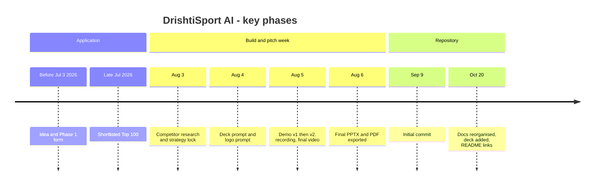
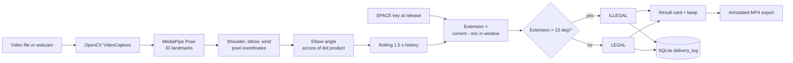
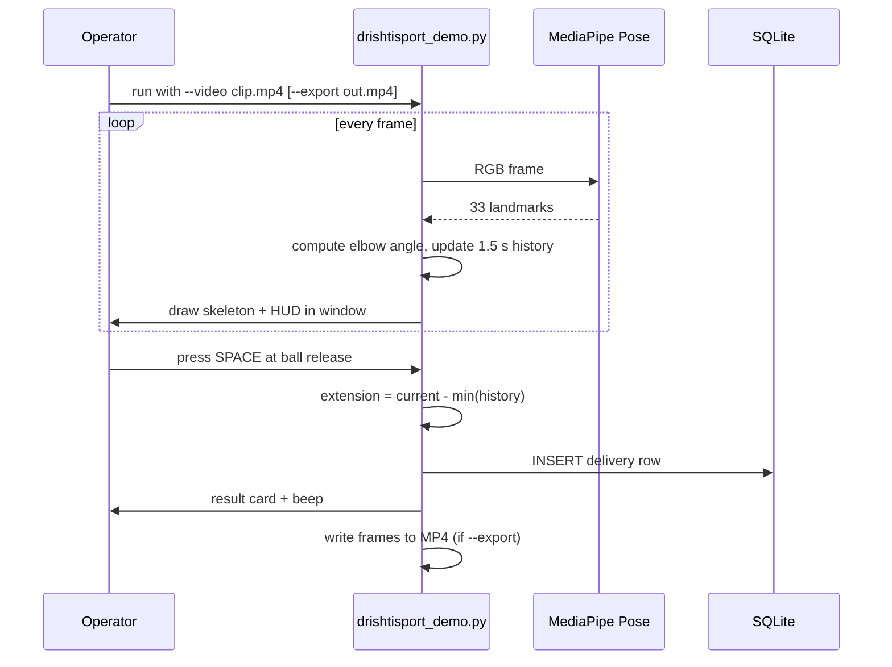
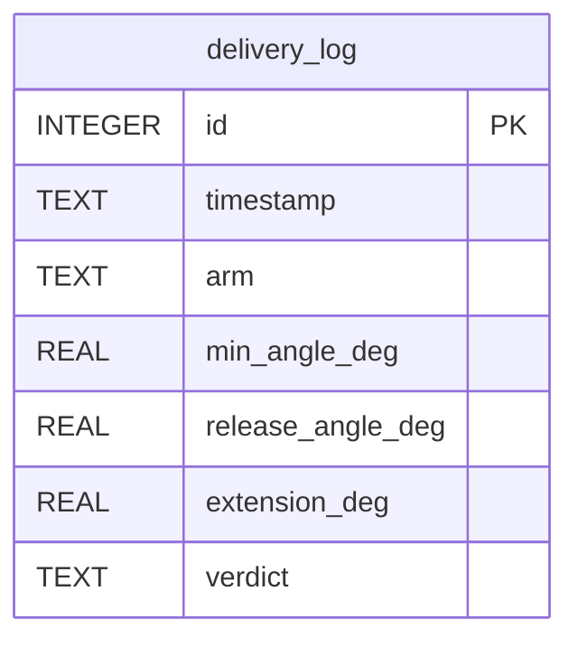
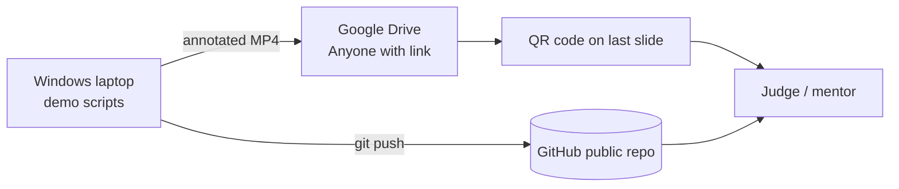

# DrishtiSport AI — Master Project Report

> **One-line summary:** A solo-built, offline computer-vision prototype that tracks a bowler's elbow angle with MediaPipe Pose and flags a cricket bowling action against the ICC's 15° elbow-extension reference, logging each verdict to a local SQLite file.

**Stack (as actually built):** `Python 3.12` · `OpenCV 4.9` · `MediaPipe 0.10.21 (Pose)` · `NumPy 1.26` · `SQLite (stdlib)` · `winsound (Windows)`
**Stack (as pitched, not in the code):** `Flutter` · `ONNX Runtime Mobile` · `FastAPI` — see [Issue 11](#6-debugging--issue-history)

| | |
|---|---|
| **Last updated** | 2026-10-20 |
| **Competition** | Samsung Solve for Tomorrow 2026 — Theme 3 Sport & Tech — Top 100 (FITT, IIT Delhi) |
| **Evidence used** | Full chat history · `demo/drishtisport_demo.py` + `view_log.py` · git log (3 commits) · submitted deck text (`submission/*.pptx`) · local `drishtisport_log.db` (10 rows) · file timestamps · video metadata |
| **Overall confidence** | ✅ ~70% verified · 🟡 ~20% inferred · ❓ ~10% unknown (see [Appendix B](#appendix-b-evidence--assumptions-log)) |

**Legend:** ✅ Verified · 🟡 Inferred · ❓ Unknown · ⭐ Core · 🔥 Advanced · 🚀 Interview standout

> **Read this first (honesty note):** The pitch deck describes an ONNX model, a Flutter app, local-language audio and "tamper-proof" logs. The code in this repo is a ~330-line Python desktop script with plain NumPy angle math, a `winsound` beep and an ordinary SQLite table. This report documents what exists and flags every gap, so you can answer interview questions truthfully. Sections [6](#6-debugging--issue-history), [17](#17-knowledge-gap-detection) and [18](#18-confidence-rating-by-module) matter most.

---

## Table of Contents

**Part A — Understand the Project**
1. [Executive Overview](#1-executive-overview)
2. [Project Timeline & Engineering History](#2-project-timeline--engineering-history)
3. [Architecture & Technical Design](#3-architecture--technical-design)
4. [Features Deep Dive](#4-features-deep-dive)
5. [Codebase Guide](#5-codebase-guide)

**Part B — Engineering Depth**
6. [Debugging & Issue History](#6-debugging--issue-history)
7. [Technical Decision Log](#7-technical-decision-log)
8. [Performance & Optimization](#8-performance--optimization)
9. [Security, Scalability & Production Readiness](#9-security-scalability--production-readiness)
10. [Deployment & DevOps](#10-deployment--devops)

**Part C — Interview Preparation**
11. [Top 25 Project Interview Questions](#11-top-25-project-interview-questions)
12. [STAR Story Bank](#12-star-story-bank)
13. [Project FAQ (Knowledge Base)](#13-project-faq-knowledge-base)
14. [Mock Interview](#14-mock-interview)
15. [Resume, LinkedIn & Portfolio Content](#15-resume-linkedin--portfolio-content)

**Part D — Self-Assessment & Growth**
16. [Lessons Learned](#16-lessons-learned)
17. [Knowledge Gap Detection](#17-knowledge-gap-detection)
18. [Confidence Rating by Module](#18-confidence-rating-by-module)
19. [Future Improvements](#19-future-improvements)

**Part E — Quick Revision**
20. [Interview Cheat Sheet](#20-interview-cheat-sheet)
21. [5-Minute Revision Sheet](#21-5-minute-revision-sheet)

**Appendix**
- [Appendix A. GitHub README Snippet](#appendix-a-github-readme-snippet)
- [Appendix B. Evidence & Assumptions Log](#appendix-b-evidence--assumptions-log)
- [Appendix C. Glossary](#appendix-c-glossary)

---

# PART A — UNDERSTAND THE PROJECT

## 1. Executive Overview

| Field | Detail |
|---|---|
| **Project Name** | DrishtiSport AI ("Drishti" = vision/sight). Team name on the deck: **Samsung4all** ✅ |
| **Problem Solved** | Rural/Tier 2–3 athletes and coaches can't check technique objectively; motion-capture labs cost ₹5,000+/hour (figure from the application form, not independently verified 🟡). Flagship case: no way to check a bowling action against the ICC 15° elbow-extension reference. |
| **Elevator Pitch** | "Point a camera at a bowler, mark the release, get a LEGAL/ILLEGAL verdict and a timestamped log — offline, no lab." |
| **Target Users** | Athletes (10–22), PE teachers/grassroots coaches, talent scouts ✅ (application form + deck) |
| **Main Goal** | Win selection through the Top 100 → Top 40 → Top 20 → Grand Finale funnel by showing a *working* prototype ✅ |
| **Key Innovation** | Applying a *rule-grounded* threshold (ICC 15°) rather than a generic "form score", on consumer video, offline 🟡 (novelty vs. existing tools not independently verified) |
| **Business Value** | Free for athletes; B2B academy subscriptions + federation data licensing (pitched only — no implementation) ✅ deck |
| **Technical Complexity** | **Low–Medium.** One script, off-the-shelf pose model, simple trigonometry. The hard part is the *domain definition* of legality, which the current code only approximates (see [Issue 9](#6-debugging--issue-history)). |
| **Unique Selling Points** | Offline (script makes no network call ✅) · single phone/laptop camera · explicit rule threshold · exportable annotated evidence video · local verdict log |
| **My Role & Ownership** | Solo participant: concept, problem framing, direction/UX decisions, recordings, deck, submission, repo. **The code in `demo/` was written by an AI assistant in the chat** ✅ (chat history); you ran, tested and steered it. Be ready to say so and to explain every function. |

### 30-Second Pitch

> "98% of rural Indian athletes never get biomechanical feedback, because motion-capture labs cost thousands per hour. I built DrishtiSport AI, which turns an ordinary camera clip into an objective check. Using MediaPipe pose tracking, it measures the bowling elbow angle, compares the extension against the ICC's 15-degree reference, shows a green or red verdict, and saves a timestamped log. It runs fully offline, and it's a working prototype, not a mockup."

### 2-Minute Technical Explanation

> "The pipeline has four stages. **One:** OpenCV reads frames from a recorded clip or webcam. **Two:** MediaPipe Pose returns 33 body landmarks per frame; I use the shoulder, elbow and wrist of the bowling arm. **Three:** I compute the elbow angle as the angle at the elbow between the shoulder and wrist vectors, using the dot-product formula with `arccos`. I keep a rolling 1.5-second history of that angle. **Four:** when the operator presses SPACE at ball release, I take the most-bent angle in the window as the start point and the current angle as the release point; the difference is the elbow extension. If it exceeds 15°, the delivery is flagged ILLEGAL. The result appears as a large card, a beep, a row in a local SQLite table, and — optionally — in an exported annotated MP4.
>
> I chose a recorded-clip workflow with a manually marked release because automatic release detection from arm motion alone was unreliable and produced confusing output. The honest limitation: it's 2D pixel geometry, not calibrated 3D biomechanics, and the 15° figure is applied as a prototype proxy, not a certified measurement."

### Non-Technical Explanation (HR / Recruiter)

> "In cricket, a bowler whose elbow straightens too much is called for an illegal action — but checking that normally needs an expensive lab. I built a prototype that does a first-pass check from a normal video, on a laptop or phone, with no internet. It highlights the arm in green or red, announces the result, and keeps a record. It was shortlisted in a national innovation competition run with IIT Delhi and Samsung."

[↑ Back to top](#table-of-contents)

---

## 2. Project Timeline & Engineering History



Dates for Aug 3–6 come from file modification times ✅; "Late Jul" comes from a news article found during research 🟡.

| Phase | What Was Built | Changes Made | Why | Files / Modules |
|---|---|---|---|---|
| **Idea → Phase 1** | Application text for Theme 3 | Fields 9/12/13/14/15 filed (stage = "Early development") | Enter competition | `DOC/00_phase1_form_submission.md` |
| **Research & planning** | Competition analysis | Found 2025 Sport & Tech winner NextPlay.AI had a near-identical thesis; chose differentiation (injury/legality + verified log) | Avoid looking derivative | `DOC/02_competition_research.md` |
| **Requirements** | Official FITT template read | Replaced generic 7-slide plan with the **9-slide** official structure + 4-minute budget | Template is the scoring rubric | `DOC/03_pitch_deck_prompt.md` |
| **Tech selection** | Stack chosen | Pitch: Flutter + MediaPipe + ONNX + FastAPI. Built: Python + OpenCV + MediaPipe + SQLite | Time-box to one working module | `demo/` |
| **MVP v1** | Live webcam analyser | Auto "cycle detection" from wrist-above-shoulder + rest angle; HUD; beep; SQLite | First working loop | `demo/drishtisport_demo.py` |
| **MVP v2** | Clip-based analyser | SPACE-marked release, big result card, `--video`, `--export`, `--slow`; simplified HUD | v1 output confusing; judges won't perform live | same |
| **Hardening** | Bug fixes | Export mode now reads SPACE; freeze-frame hold at end of clip | Found in self-review before running | same |
| **Recording** | Demo assets | 9 webcam takes (`me/`), annotated exports, 10 logged deliveries | Real footage for the video | local only |
| **Final polish** | Pitch video + deck | `Samsung4all.mp4` (191.6 s, 1920×1080), 9-slide deck | FITT submission | local + `submission/` |
| **Repo & docs** | GitHub repo | Docs in `DOC/`, deck in `submission/`, `.gitignore` for media, author = `gurusaiss` | Preserve and share work | repo root |

### Changelog

| Version | Added | Improved | Fixed | Refactored / Removed |
|---|---|---|---|---|
| **v1** (Aug 5, ~14:02) | Webcam capture, MediaPipe tracking, elbow angle, auto cycle detection, green/red skeleton, beep, SQLite log, `view_log.py` | — | — | — |
| **v2** (Aug 5, ~14:14) | `--video`, `--export`, `--slow`; SPACE-triggered verdict; result card | HUD cut to 3 lines | Confusing auto-detection output | Removed auto cycle detection and unused variables |
| **v2.1** (Aug 5) | Freeze-frame hold | — | Export mode never read SPACE; end-of-clip card could be cut off | Merged live/export branches into one loop |
| **Repo 0.1** (Sep 9) | Docs, demo, README, `.gitignore` | — | Commit author reset to `gurusaiss` | — |
| **Repo 0.2** (Oct 20) | `submission/` deck, deck links in README | `.md` files consolidated into `DOC/` | — | `README_DEMO.md` moved to `DOC/06_demo_run_guide.md` |

### Pivots & Direction Changes

| From | To | Why |
|---|---|---|
| Multi-sport (cricket, sprint, kabaddi) | **Single cricket-bowling module** | Scope discipline; competition's own "don't overcomplicate" warning |
| Live webcam, auto release detection | **Recorded clip + presenter-marked release** | Judges won't perform live; auto detection unreliable |
| Static Vercel page / full web app | **Dropped** | Not requested by FITT; would need a JS/WASM rebuild; deadline risk |
| Multi-person team slide | **Solo builder** | Actual team size |
| Video hosted on YouTube | **Google Drive link + QR** | Faster; no processing wait |

[↑ Back to top](#table-of-contents)

---

## 3. Architecture & Technical Design

### High-Level Architecture



| Layer | What exists ✅ |
|---|---|
| **Frontend** | OpenCV window (`cv2.imshow`) with a HUD panel and a result card. No web/mobile UI. |
| **Backend** | None. Single local process. |
| **Database** | SQLite file `drishtisport_log.db` (one table). |
| **APIs** | None (no network calls). |
| **Auth** | N/A — local tool. |
| **AI/ML layer** | MediaPipe Pose (`model_complexity=1`, detection/tracking confidence 0.5). **No custom model, no ONNX** in the code. |
| **External services** | None at runtime. (Google Drive + QR code used only to share the demo video.) |
| **Cloud / hosting** | None. Distribution via GitHub + Drive. |
| **CI/CD** | None. |

### Request / Data Flow



### Authentication Flow
N/A — no users or accounts. A production version would need per-athlete identity if logs are to be used for scouting.

### Component Breakdown

| Component | Purpose | Tech | Key Files |
|---|---|---|---|
| Capture | Read frames from file/webcam | OpenCV `VideoCapture` | `drishtisport_demo.py` |
| Pose estimation | Landmarks per frame | MediaPipe Pose | same |
| Angle math | Elbow angle at joint | NumPy (`arccos`, dot product) | `angle_deg()` |
| Legality logic | Extension vs 15° | Rolling `deque` | `main()` |
| Persistence | Verdict log | `sqlite3` | `init_db()`, `log_delivery()` |
| Feedback | Overlay, card, beep | OpenCV drawing, `winsound` | `draw_panel()`, `draw_result_card()`, `beep_alert()` |
| Export | Annotated MP4 | `cv2.VideoWriter` (`mp4v`) | `main()` |
| Log viewer | Print table | `sqlite3` | `view_log.py` |

### Database Design



- Single table, no relationships, no indexes beyond the primary key ✅.
- `timestamp` is wall-clock time of the *logging*, not of the video frame ✅ — so rows don't identify *which clip* or *which frame*. A real "verified record" would store clip hash, frame index and athlete ID.

### Technology Choices & Tradeoffs

| Technology | Why Chosen | Alternatives Considered | Tradeoff |
|---|---|---|---|
| **MediaPipe Pose** | Free, on-device, CPU-friendly, 33 landmarks | MoveNet, OpenPose, YOLO-pose | 2D-dominant, jitter on fast motion; accuracy not validated here |
| **OpenCV** | Capture, drawing, export in one library | Pillow + ffmpeg | Basic UI only |
| **SQLite** | Zero-config, offline | JSON/CSV, Postgres | No integrity guarantees; single-user |
| **NumPy angle math** | Transparent, explainable | Learned classifier (ONNX) | No learning, rule-only; but defensible and fast |
| **Desktop Python script** | Fastest path to a *working* demo | Flutter app, web app | Not the product described in the deck |
| **`winsound`** | One-line audio alert | `pyttsx3`, recorded prompts | Windows-only beeps; no spoken/local-language feedback |

[↑ Back to top](#table-of-contents)

---

## 4. Features Deep Dive

| Feature | Marker | Purpose | How It Works | Tech | Complexity |
|---|---|---|---|---|---|
| Pose tracking | ⭐ | Find the arm joints | MediaPipe Pose per frame | MediaPipe | Low |
| Elbow angle | ⭐ | Quantify arm bend | Angle at elbow from shoulder/wrist vectors | NumPy | Low |
| Green/red skeleton | ⭐ | Instant visual state | Colour from provisional extension vs 15° | OpenCV | Low |
| Presenter-marked release → verdict | 🔥 | Clean, repeatable result | SPACE reads current vs window-min angle | `deque` | Medium |
| ICC-referenced threshold | 🚀 | Rule-grounded, not a vague score | `LEGAL_EXTENSION_LIMIT_DEG = 15.0` | constant | Low (domain-hard) |
| Result card + beep | ⭐ | One-second comprehension | Centered card, `winsound.Beep` | OpenCV, winsound | Low |
| SQLite delivery log | 🔥 | Evidence trail | `INSERT` per verdict | sqlite3 | Low |
| Annotated MP4 export | 🔥 | Reliable demo asset | Same frames written to `VideoWriter` | OpenCV | Medium |
| Log viewer | ⭐ | Show the record | Tabular print | sqlite3 | Low |

<details>
<summary><strong>Feature: Legality verdict (presenter-marked release)</strong></summary>

- **Description:** Press SPACE at the ball-release frame; the app returns LEGAL/ILLEGAL.
- **Business purpose:** Gives judges and coaches a verdict they can understand in one second.
- **Internal working:** `release_angle = current_angle`; `min_angle = min(history over last 1.5 s)`; `extension = max(0, release − min)`; `ILLEGAL if extension > 15.0`. Then `angle_history.clear()` ✅.
- **APIs involved:** `cv2.waitKey` for the key press; MediaPipe landmarks for the angle.
- **Database impact:** One row inserted per verdict.
- **Challenges:** (1) Rapid presses produce near-zero extension because history is cleared each time ([Issue 6](#6-debugging--issue-history)). (2) The metric isn't the ICC definition ([Issue 9](#6-debugging--issue-history)).
- **Improvements made:** Replaced v1 auto-detection with the manual trigger.
</details>

<details>
<summary><strong>Feature: Annotated export + freeze-frame hold</strong></summary>

- **Description:** `--export out.mp4` writes exactly what's on screen, including the result card.
- **Business purpose:** A pre-rendered, genuine output can be played in a pitch video with zero live-tracking risk.
- **Internal working:** One loop shows the window *and* writes frames. After the clip ends, if a card is still due, the last frame is repeated with the card for the remaining hold time ✅.
- **Challenges:** Original export branch never read SPACE ([Issue 7](#6-debugging--issue-history)); card could be cut off ([Issue 8](#6-debugging--issue-history)).
- **Improvements made:** Unified loop; freeze-frame hold.
</details>

<details>
<summary><strong>Feature: Verified delivery log</strong></summary>

- **Description:** Each verdict stored with timestamp, arm, min/release angles, extension, verdict.
- **Business purpose:** Pitch claim of an objective record for scouts.
- **Internal working:** `log_delivery()` → `INSERT`; `view_log.py` prints rows and counts illegal/legal.
- **Challenges:** Not tamper-proof (no hashing/signing) — claim exceeds implementation ([Issue 11](#6-debugging--issue-history)).
- **Improvements made:** None yet (see [Section 19](#19-future-improvements)).
</details>

[↑ Back to top](#table-of-contents)

---

## 5. Codebase Guide

### Folder structure

```text
drishtisport-ai-/
├── README.md                      # overview + links to deck and docs
├── .gitignore                     # excludes videos, pptx/pdf (except submission/), db
├── DOC/                           # all markdown docs
│   ├── 00_phase1_form_submission.md
│   ├── 02_competition_research.md
│   ├── 03_pitch_deck_prompt.md
│   ├── 04_pitch_video_script.md / .html
│   ├── 05_logo_generation_prompt.md
│   ├── 06_demo_run_guide.md
│   └── report.md                  # this file
├── demo/
│   ├── drishtisport_demo.py       # the MVP (330 lines)
│   ├── view_log.py                # log viewer
│   └── drishtisport_demo_qr.png   # QR to demo video
└── submission/
    ├── Samsung4all_Pitch_Deck.pptx
    └── Samsung4all_Pitch_Deck.pdf
```

### Important functions

| Name | File | What it does |
|---|---|---|
| `angle_deg(a, b, c)` | `drishtisport_demo.py` | Angle at `b` between vectors `ba` and `bc`, 0–180° |
| `init_db(path)` | same | Creates `delivery_log` if missing |
| `log_delivery(...)` | same | Inserts one verdict row |
| `beep_alert(illegal)` | same | Two-tone beep for illegal, rising beep for legal (Windows only) |
| `draw_panel(...)` | same | Semi-transparent HUD box with text lines |
| `draw_result_card(...)` | same | Centered verdict card with angles |
| `main()` | same | Arg parsing, capture, pose loop, verdict, export, freeze hold |
| `main()` | `view_log.py` | Print all rows + totals |

### Key constants ✅

| Constant | Value | Meaning |
|---|---|---|
| `LEGAL_EXTENSION_LIMIT_DEG` | 15.0 | ICC reference tolerance |
| `ROLLING_WINDOW_SECONDS` | 1.5 | How far back to find the most-bent angle |
| `RESULT_CARD_HOLD_SECONDS` | 3.5 | How long the card stays |
| `DB_PATH` | `drishtisport_log.db` | Relative to the working directory |

### API endpoints
N/A — there is no server. Interface is a CLI:

| Flag | Default | Purpose |
|---|---|---|
| `--video PATH` | none (uses webcam) | Recorded clip to analyse |
| `--export PATH` | none | Also write annotated MP4 |
| `--arm right\|left` | `right` | Bowling arm to track |
| `--camera N` | `0` | Webcam index |
| `--slow X` | `1.0` | Playback speed multiplier |

### Environment variables
None. No secrets in the repo ✅.

### Common commands

```bash
pip install opencv-python mediapipe numpy      # no requirements.txt exists in the repo
cd demo
python drishtisport_demo.py --video bowling_clip.mp4
python drishtisport_demo.py --video bowling_clip.mp4 --export final_demo.mp4
python view_log.py
```

### How to run locally
1. Install Python 3.12 and the three packages above (tested: OpenCV 4.9.0, MediaPipe 0.10.21, NumPy 1.26.4 ✅).
2. Record a clip of a bowling-style arm action (arm and shoulder fully in frame, good light).
3. Run with `--video`; watch the clip; press **SPACE** at ball release; press **q** to quit.
4. Re-run with `--export` to save the annotated result; run `view_log.py` to see logged rows.

### How to run tests
**There are no automated tests** ✅. Verification so far was manual: compile checks, a webcam smoke test, and an export run on a synthetic noise video (no pose detected, so the verdict path was not exercised by it).

[↑ Back to top](#table-of-contents)

---

# PART B — ENGINEERING DEPTH

## 6. Debugging & Issue History

> **Note:** Issues 5, 6, 9 and 11 are the ones an interviewer is most likely to probe. Issue 9 and Issue 11 are *unresolved* — treat them as known limitations, not stories of success.

| # | Issue | Category | Symptoms | Root Cause | How Detected | Fix | Prevention | Severity |
|---|---|---|---|---|---|---|---|---|
| 1 | `python3` not found in Git Bash | env/config | `Python was not found; run without arguments to install from the Microsoft Store` (exit 49) ✅ | Windows Store alias shadows interpreter in that shell | Command output | Used `python` / PowerShell | Document the launcher; use `py` | Low |
| 2 | `markitdown` command not found | env/config | `markitdown: command not found` (exit 127) ✅ | CLI not on PATH | Command output | `python -m markitdown` ✅ | Install with PATH check | Low |
| 3 | `python -I -m markitdown` printed nothing | env/config | Empty output, no error visible ✅ | 🟡 `-I` (isolated mode) ignores user site-packages where the tool lives; stderr was also hidden | Empty result | Re-ran without `-I` | Don't suppress stderr when debugging | Low |
| 4 | `qrcode` module missing | dependency | `ModuleNotFoundError: No module named 'qrcode'` ✅ | Package not installed | Command output | You generated the QR yourself; PNG exists in repo 🟡 | Add `requirements.txt` | Low |
| 5 | v1 output was confusing to a viewer | logic / UX | You: "unable to understand correctly the outputs… if I am judge I feel odd" ✅ | Silent auto cycle-detection state machine, cluttered HUD, and a live-performance demo model | Your feedback after running v1 | Rewrote as v2: SPACE-marked release, 3-line HUD, big result card, `--video`/`--export` ✅ | Test demos from a viewer's perspective | High |
| 6 | First real log: 3 deliveries, ~0° extension | logic / usage | Rows 165.6→166.4, 165.9→167.1, 166.9→166.9; timestamps within ~1 s ✅ | 🟡 SPACE pressed rapidly with no real bend between presses; `angle_history.clear()` after each press leaves almost no history | Your pasted `view_log.py` output | Explained: do a full bent→straight rep, wait 2–3 s between presses | Enforce a minimum history/cool-down before accepting a verdict | Medium |
| 7 | Export mode never read SPACE | bug | (Would have produced no verdicts when exporting) | v2 draft only called `waitKey` in the "live view" branch | Self-review before first run ✅ | Merged branches: always show window, always accept SPACE, also write frames | Review control flow for each mode | High (caught pre-run) |
| 8 | Result card could be cut off at end of clip | edge case | If SPACE pressed near last frame, card shown for <1 frame | Loop ended when `cap.read()` failed | Reasoned during review ✅ | Freeze-frame loop re-emitting last frame with card ✅ | Test with presses at the very end | Medium |
| 9 | Verdict metric isn't a valid ICC check | logic / domain | DB shows 114.1° and 108.3° flagged ILLEGAL, and a row 7.3°→21.0° ✅ | 🟡 "Extension" = release angle − min angle in a 1.5 s window, which can include the bent wind-up phase; ICC measures from arm-at-shoulder-level to release. 2D pixel angles; landmark jitter; red skeleton during any normal swing | Reading the 10 logged rows (this report) | **Not fixed.** | See [Section 19](#19-future-improvements): start window when wrist passes shoulder height; smooth angles; validate vs ground truth | **High** |
| 10 | Webcam mirror flip may swap left/right arm | bug (latent) | Not observed | 🟡 `cv2.flip` before MediaPipe makes the user's right arm look like a left arm to the model, so `--arm right` could track the wrong arm in webcam mode | Code review for this report | Not fixed (demo used `--video`, which isn't flipped) | Flip only the *displayed* frame, or map arm sides when flipping | Medium |
| 11 | Pitched features not in the code | claims gap | Deck slide 2/4/6: ONNX model, quantization, Flutter, "local-language audio", "tamper-proof"; code has none of these ✅ | Deck written ahead of implementation | Comparing deck text with code | **Not fixed.** | Align claims to reality or build the features | **High** |
| 12 | Wrong identity on first commit; `--amend` kept it | git | Author showed `hrudai-gurusaisumith` ✅ | Global git config; `--amend` preserves author; `--reset-author` and `--author` can't be combined (error 128) ✅ | `git log --format` | `git commit --amend --author="gurusaiss <…>"`; local `user.name` set | Set local identity before first commit | Low |
| 13 | GitHub connector failed; no `gh` CLI | deployment | `400 Authorization header is badly formatted` ✅; `gh: command not found` ✅ | Connector auth misconfigured; CLI not installed | Tool output | Plain `git` + Git Credential Manager (already cached) pushed fine ✅ | Keep one working auth path | Low |
| 14 | Large files vs GitHub limits | deployment | `Samsung4all.mp4` = 109,790,692 bytes ✅ (> 100 MB hard limit) | Raw/export videos are large | File listing | `.gitignore` for video/pptx/pdf/db; later exception for `submission/`; initial blanket `*.png` rule would have excluded the small QR → refined ✅ | Check sizes before `git add`; CRLF warnings are harmless | Low |
| 15 | Public repo contains personal contact details | security / privacy | Deck slide 9 includes a phone number and email ✅; unauthenticated API call to the repo returned HTTP 200 ✅ (public) | Deck pushed whole at your request without scanning it | Evidence pass for this report | **Not fixed** (needs your decision: remove file + rewrite history, or accept) | Review artefacts for PII before pushing | **High** |
| 16 | Generic 7-slide plan didn't match FITT template | requirements | Official template has 9 slides + timing guide ✅ | Plan written before reading the template | Reading the `.pptx` | Rebuilt the outline on the template | Read the official artefact first | Medium |

<details>
<summary><strong>Issue 5 — v1 output was confusing (deep dive)</strong></summary>

1. **What happened:** You ran the webcam demo and couldn't interpret the readout; you also noted a judge wouldn't stand up and perform.
2. **How it appeared:** Many changing numbers, auto-fired verdicts at unclear moments.
3. **How detected:** Your direct feedback.
4. **Debugging steps:** Reviewed the state machine (cock → min → rest) and HUD content; compared with how NextPlay.AI-style products are shown (video in → analysis out).
5. **Root cause:** Over-engineered auto-detection with unclear feedback, plus a demo modality that needs a human performer.
6. **Exact fix:** `if key == ord(" "): space_pressed = True` → compute verdict from rolling window; draw a large `LEGAL/ILLEGAL ACTION` card; add `--video` and `--export`.
7. **Why it worked:** The operator, not the code, chooses the release frame, so the result is deterministic and explainable.
8. **Better alternatives:** Auto-detect release from wrist-velocity peak; ask the user to tap on a timeline scrubber.
9. **Prevention:** Run a "cold viewer" test before declaring a demo done.
10. **Interview line:** "My first version auto-detected the release and nobody could follow the output. I replaced it with an operator-marked release and a single result card, trading automation for clarity — and I'd restore automation once I could validate it."
</details>

<details>
<summary><strong>Issue 6 — Rapid SPACE presses, ~0° extension</strong></summary>

1. **What happened:** `view_log.py` showed three rows with 0.0–1.2° extension.
2. **How it appeared:** Min and release angles both ~166° (arm nearly straight).
3. **How detected:** You pasted the log.
4. **Debugging steps:** Read the timestamps (14:33:57, :58, :58) and angles; recalled `angle_history.clear()` after each press.
5. **Root cause (🟡):** Three presses inside ~1 s without a bent→straight swing; each verdict saw almost no history.
6. **Exact fix:** Process guidance (full rep, 2–3 s gap). No code change.
7. **Why it worked:** Later logs show larger, varied values (rows 1, 3, 5, 8, 9).
8. **Better alternatives:** Reject a press if history is shorter than N frames or the angle range is below a minimum; show "not enough motion".
9. **Prevention:** Add that guard and a cool-down.
10. **Interview line:** "The log itself told me the test wasn't a real swing — near-zero extension and timestamps a second apart. It validated that the pipeline writes correctly and showed I need input guards."
</details>

<details>
<summary><strong>Issue 7 — Export mode never read SPACE</strong></summary>

1. **What happened:** Draft v2 only read keys in the live-view branch.
2. **How it appeared:** Export would have produced a video with no verdict.
3. **How detected:** Self-review of the rewrite before the first run.
4. **Debugging steps:** Traced `is_export` vs `is_live_view` branches.
5. **Root cause:** Two code paths assumed mutually exclusive modes.
6. **Exact fix:** Removed the branches; always `imshow` + `waitKey`, and write frames if a writer exists.
7. **Why it worked:** One loop, one behaviour; export is a side effect of the same run.
8. **Better alternatives:** Headless export with detected release.
9. **Prevention:** Test each flag combination; add unit tests around the loop.
10. **Interview line:** "I caught a control-flow bug in review — the export path couldn't register the trigger — and fixed it by collapsing two modes into one loop instead of patching a special case."
</details>

<details>
<summary><strong>Issue 8 — Result card cut off at end of clip</strong></summary>

1. **What happened:** A press near the last frame leaves no later frames to show the card.
2. **Appearance:** Card flashes or never appears in the export.
3. **Detected:** Reasoned through the loop exit.
4. **Steps:** Considered `cap.read()` returning false.
5. **Root cause:** Display tied to the frame loop.
6. **Fix:** After the loop, repeat the last frame with the card for the remaining hold time (`hold_frames = remaining × fps`).
7. **Why it worked:** The card has its own timer independent of clip length.
8. **Alternatives:** Pad the clip with extra frames before processing.
9. **Prevention:** Test a press on the final frame.
10. **Interview line:** "I decoupled the result display from the video length so the verdict is always visible for a fixed time."
</details>

<details>
<summary><strong>Issue 9 — Verdict metric isn't a valid ICC check (UNRESOLVED)</strong></summary>

1. **What happened:** The log contains 5 ILLEGAL rows, two with >100° "extension".
2. **Appearance:** Values like 55.9° → 170.1° (114.1°) and 44.6° → 152.8° (108.3°).
3. **How detected:** Reading `delivery_log` while preparing this report.
4. **Steps:** Compared values to the ICC definition (🟡 from background knowledge: elbow straightening measured *from the arm reaching shoulder level until release*; 15° tolerance) and to the code (min over a fixed 1.5 s window).
5. **Root cause (🟡):** The window can include the bent wind-up before shoulder level; 2D pixel geometry; no smoothing; also a 7.3°→21.0° row suggests degenerate landmarks.
6. **Exact fix:** None applied. Proposed: start the window when the wrist rises above the shoulder; low-pass filter angles; reject implausible angles; calibrate with a known-angle test.
7. **Why it matters:** The deck claims rule-grounded accuracy; the code can't back that claim yet.
8. **Alternatives:** Use 3D landmarks (`pose_world_landmarks`); multi-camera; validate against a goniometer or lab capture.
9. **Prevention:** Validate against ground truth before claiming accuracy.
10. **Interview line:** "It's a proof-of-concept proxy. I can show the pipeline, but I wouldn't claim legal-grade accuracy; my logs show the metric needs to be anchored at shoulder level and validated against ground truth."
</details>

<details>
<summary><strong>Issue 11 — Pitched features not in the code (UNRESOLVED)</strong></summary>

1. **What happened:** Deck lists ONNX model, quantization, Flutter, local-language audio, tamper-proof logs.
2. **Appearance:** None exist in `demo/`; angle math is NumPy, audio is a beep, log is plain SQLite.
3. **Detected:** Cross-reading deck text and code.
4. **Steps:** `grep`-level review of imports (`cv2`, `mediapipe`, `numpy`, `sqlite3`, `winsound`).
5. **Root cause:** Deck written to the pitch template ahead of implementation.
6. **Fix:** Not applied.
7. **Why it matters:** A technical interviewer or judge asking to see the ONNX model will find none.
8. **Alternatives:** Reword deck as "roadmap"; or implement a small ONNX classifier; add HMAC/hash-chain to the log.
9. **Prevention:** Label every claim *built* or *planned*.
10. **Interview line:** "The prototype proves the core measurement loop. The ONNX classifier, mobile app and signed logs are the roadmap — I'd be explicit about that rather than overstate."
</details>

<details>
<summary><strong>Issues 1–4, 10, 12–16 — short-form record</strong></summary>

| # | Detect | Root cause | Fix | Why it worked | Interview line |
|---|---|---|---|---|---|
| 1 | Exit 49 message | Store alias | Use `python`/PowerShell | Different shell resolves real interpreter | "Environment drift between shells is a classic Windows trap." |
| 2 | Exit 127 | CLI not on PATH | `python -m markitdown` | Module run bypasses PATH | "`python -m` is the portable way to call tools." |
| 3 | Empty output | `-I` + hidden stderr | Drop `-I` | User-site packages visible again | "Never hide stderr while debugging." |
| 4 | ImportError | Not installed | Generated QR externally | Not needed in code | "Pin dependencies in a requirements file." |
| 10 | Review | Mirror before inference | Use `--video`; planned fix | Video path isn't flipped | "Mirror only for display; infer on the original frame." |
| 12 | `git log` | Global identity; `--amend` keeps author | `--author` | Explicit author overrides | "Check `git config` before the first commit." |
| 13 | Tool error | Bad connector auth | Plain git + credential manager | Existing creds worked | "Have a fallback path that doesn't depend on one integration." |
| 14 | File sizes | >100 MB file | `.gitignore` | Binaries stay out of git | "Media belongs in object storage/Drive, not git." |
| 15 | API 200 | Public repo + deck with contact info | **Open** | — | "Scan artefacts for PII before pushing." |
| 16 | Read template | Assumed structure | Rebuilt outline | Matched rubric | "Read the official spec first." |
</details>

### Recurring Patterns

- **Claims ahead of implementation** (Issues 9, 11): the deck and the code drifted apart.
- **Environment/tooling drift on Windows** (Issues 1–4, 13): shell, PATH and package differences.
- **Demo UX vs correctness** (Issues 5, 6, 9): output that *looks* decisive but isn't validated.
- **Review before run works** (Issues 7, 8): both were caught by reading the code, not by crashes.

[↑ Back to top](#table-of-contents)

---

## 7. Technical Decision Log

| Decision | Context | Why Taken | Alternatives | Tradeoffs | Would I Change It? |
|---|---|---|---|---|---|
| Theme = Sport & Tech | Four themes; ~15% share, "blue ocean" per application research | Lower saturation, visual demo | AI Living, Health & Education, Sustainability | Prior-year winner overlap (NextPlay.AI) | No, but sharpen differentiation |
| Keep idea, refine focus | Fear that changing would "get rejected" | Mentorship stage is designed for refinement | Pivot | Narrower scope | No |
| Single sport: cricket bowling | Time-box; "don't overcomplicate" | Concrete rule (ICC 15°) = credible hook | Multi-sport | Less breadth | No |
| MediaPipe Pose | Free, on-device | Matches offline claim | MoveNet, OpenPose | Unvalidated accuracy | Validate, keep |
| Python desktop script as MVP | Deadline same day | Fastest to *working* | Flutter/web | Not the described product | Port later |
| Recorded clip + presenter-marked release | v1 confusing; judges won't perform | Deterministic, explainable | Live auto-detect | Not fully automatic | Add validated auto-detect |
| SQLite local log | Offline | Zero setup | CSV, cloud DB | No tamper evidence | Add hash chain |
| Export annotated MP4 | Avoid live risk | Genuine output, replayable | Live screen recording | Pre-rendered | No |
| Video hosting: Google Drive + QR | Fast, no processing wait | Simple | YouTube unlisted | Link must stay valid | No |
| No Vercel/web deployment | Not requested; JS/WASM rebuild | Protect the deadline | Static page | No public live link | Revisit post-Top 40 |
| Gamma for deck | Speed | AI deck generation | Manual PPT | Generic look risk | Fine |
| Docs in `DOC/`, media ignored | Org + GitHub limits | Clean repo | Git LFS | Media not versioned | Add LFS if needed |

[↑ Back to top](#table-of-contents)

---

## 8. Performance & Optimization

> **Note:** **No performance measurements were taken** ✅. Nothing below claims a speed-up.

| Optimization | Problem | Change Applied | Result |
|---|---|---|---|
| MediaPipe `model_complexity=1` | Balance accuracy vs. speed | Mid-complexity model | ❓ `[ADD METRIC: ms/frame]` |
| Single pass for display + export | Re-processing the clip twice | One loop writes while showing | ❓ `[ADD METRIC: total run time]` |
| Freeze-frame hold | Card cut-off | Repeat last frame instead of reprocessing | Functional, not measured |
| `--slow` flag | Hard to time SPACE | Scale `waitKey` delay | Usability only |
| Git: exclude media | 100 MB limit | `.gitignore` | Repo ≈ small ✅ |

**How to measure:** wrap `pose.process(rgb)` with `time.perf_counter()`, log mean/p95 ms per frame, report FPS on your laptop and (later) on a ≤₹10,000 Android phone. The deck's "30 FPS on sub-₹10,000 phones" claim is **unverified** ❓.

[↑ Back to top](#table-of-contents)

---

## 9. Security, Scalability & Production Readiness

### Security Measures

| Area | Current State | Gap | Fix |
|---|---|---|---|
| Authentication / authorization | N/A | No users | Per-athlete identity if logs are used for scouting |
| Input validation | CLI path passed to OpenCV | No existence/format checks beyond open failure | Validate path/extension, handle errors |
| SQL injection | Parameterized `INSERT … VALUES (?, …)` ✅ | — | Keep parameterized |
| Secrets | None in repo ✅ | — | Keep out of git |
| Log integrity | Plain SQLite | **"Tamper-proof" is not true** | Hash-chain rows, sign with HMAC, store clip hash + frame index |
| Dependency security | No `requirements.txt`, unpinned | Reproducibility, supply chain | Pin versions, `pip-audit` |
| **Personal data / privacy** | Deck with contact info in a public repo (Issue 15) | PII exposure | Remove and rewrite history, or replace deck |
| **Minors' video** | Target users include ages 10–22 | No consent/storage policy | Consent flow, on-device only, retention rules |
| CORS/HTTPS/rate limiting | N/A | — | Needed if a backend is added |
| AI-specific risks | No LLM at runtime | — | N/A |

### Scalability Path (design reasoning 🟡 — nothing here is built)

| Scale | Bottleneck | Solution |
|---|---|---|
| **10 users** | Manual setup of Python + packages | Packaged executable or notebook; clear guide |
| **1K** | Windows-only beep, no phone app | Android app (Flutter/Kotlin), cross-platform audio |
| **100K** | Device diversity, accuracy variance, support load | On-device model benchmarking, crash reporting, optional sync API |
| **1M** | Central scouting DB, privacy/compliance, model updates | Backend + auth, consent management, signed model updates, regional storage |

### Production Gaps (prioritised)

- [ ] 🔴 Validate legality metric against ground truth ([Issue 9](#6-debugging--issue-history))
- [ ] 🔴 Reconcile pitch claims with implementation ([Issue 11](#6-debugging--issue-history))
- [ ] 🔴 Remove personal contact details from the public repo ([Issue 15](#6-debugging--issue-history))
- [ ] 🟡 Tamper-evident logging (hash chain + clip hash)
- [ ] 🟡 `requirements.txt`, tests, CI
- [ ] 🟡 Fix webcam mirror/arm mapping ([Issue 10](#6-debugging--issue-history))
- [ ] 🟢 Cross-platform audio / local-language voice prompts

[↑ Back to top](#table-of-contents)

---

## 10. Deployment & DevOps

| Item | State |
|---|---|
| Hosting | None — runs locally ✅ |
| Deployment process | `git push origin main` to GitHub; demo video shared via Google Drive link + QR ✅ |
| Environments | Single (Windows 11 laptop) ✅ |
| Docker | None ✅ |
| CI/CD | None ✅ |
| Monitoring / Logging | None, except the SQLite verdict log |
| Rollback | Git history (3 commits) |
| Repo | `github.com/gurusaiss/drishtisport-ai-`, branch `main`, **public** ✅ |



**Deployment challenges & fixes:** [Issue 12](#6-debugging--issue-history) (author identity), [Issue 13](#6-debugging--issue-history) (connector failure), [Issue 14](#6-debugging--issue-history) (large files), [Issue 15](#6-debugging--issue-history) (PII).

> **Note:** The shared Drive link must stay "Anyone with the link", with no expiry, for the whole competition — re-test it in an incognito window before each stage ❓ (not confirmed here).

[↑ Back to top](#table-of-contents)

---

# PART C — INTERVIEW PREPARATION

> **Interview tip:** Open with what the prototype *proves* (a working measurement loop), then volunteer its limits (2D proxy, unvalidated, roadmap items not built). Interviewers trust candidates who name their own gaps before being asked.

## 11. Top 25 Project Interview Questions

<details>
<summary><strong>Q1. Walk me through the pipeline end to end.</strong></summary>

- **Strong Answer:** OpenCV reads frames → MediaPipe Pose returns 33 landmarks → I take the bowling arm's shoulder, elbow and wrist in pixel coordinates → compute the elbow angle → keep 1.5 s of history → on SPACE at release, extension = current − minimum angle → compare with 15° → card, beep, SQLite row, optional MP4 export.
- **Likely Follow-up:** Where's the model? → MediaPipe's pretrained pose model; I didn't train anything.
- **Advanced Answer:** Add the data-shape view: per frame it's `(x, y)` ×3 landmarks → one scalar; verdict is a pure function of a short scalar time series, which makes it unit-testable with synthetic angle sequences.
</details>

<details>
<summary><strong>Q2. How do you compute the elbow angle?</strong></summary>

- **Strong Answer:** Vectors `ba = shoulder − elbow`, `bc = wrist − elbow`; `cosθ = (ba·bc)/(|ba||bc|)`; `θ = arccos(clip(cosθ, −1, 1))` in degrees. 180° = straight arm.
- **Likely Follow-up:** Why clip? → floating-point error can push the ratio just outside [−1, 1] and crash `arccos`; the `1e-9` avoids divide-by-zero.
- **Advanced Answer:** It's a 2D projection of a 3D angle, so it underestimates bend when the arm isn't perpendicular to the camera; MediaPipe also exposes `pose_world_landmarks` for a metric 3D estimate, which I'd try next.
</details>

<details>
<summary><strong>Q3. Why MediaPipe over MoveNet, OpenPose or YOLO-pose?</strong></summary>

- **Strong Answer:** Free, runs on CPU on-device, easy Python API, 33 landmarks including wrist/elbow/shoulder — matches the offline requirement and the deadline.
- **Likely Follow-up:** Did you benchmark them? → No ❓; it was a feasibility choice.
- **Advanced Answer:** For fast arm motion, motion blur and low frame rate hurt any single-frame pose model; I'd benchmark on my own bowling clips, measuring angle stability frame-to-frame.
</details>

<details>
<summary><strong>Q4. How does the legality check work — is it the ICC method?</strong></summary>

- **Strong Answer:** It's a proxy. Extension = release angle − most-bent angle in the last 1.5 s; ILLEGAL if > 15°. The ICC reference is about elbow straightening from when the arm reaches shoulder level until release, with a 15° tolerance 🟡.
- **Likely Follow-up:** So is it valid? → Not yet; my own logs show >100° values, which means the window includes the wind-up.
- **Advanced Answer:** Anchor the start of the measurement at the frame where the wrist crosses shoulder height, smooth the signal, and validate against a goniometer or lab capture before using the word "legal".
</details>

<details>
<summary><strong>Q5. Why is the release a manual keypress?</strong></summary>

- **Strong Answer:** My first version auto-detected cycles and produced output nobody could follow. A marked release is deterministic and explainable; the angle tracking itself is still automatic.
- **Likely Follow-up:** Isn't that cheating? → It's disclosed, and it isolates what's being demonstrated (measurement), not release detection.
- **Advanced Answer:** Auto-release could use wrist speed peaks or ball visibility; I'd evaluate it against human-marked frames to report an error in frames.
</details>

<details>
<summary><strong>Q6. How accurate is it? How did you validate?</strong></summary>

- **Strong Answer:** I haven't validated accuracy ❓. I've verified the pipeline runs and logs correctly; I have 10 logged verdicts from my own clips, no ground truth.
- **Likely Follow-up:** What would validation look like? → Record the same actions with known elbow angles, compare against a goniometer/lab system, report mean absolute error and classification accuracy.
- **Advanced Answer:** Report sensitivity/specificity at the 15° threshold, and sweep camera angles (0°, 30°, 60°) to quantify projection error.
</details>

<details>
<summary><strong>Q7. Your deck mentions an ONNX model. Where is it?</strong></summary>

- **Strong Answer:** It's not in the prototype; the angle logic is analytic. ONNX was the planned way to classify "optimal vs injury-prone" sequences on-device — roadmap.
- **Likely Follow-up:** Why mention it then? → The deck described the target architecture; I should have labelled it "planned".
- **Advanced Answer:** I'd collect labelled sequences, train a small 1D-CNN/LSTM on angle time series, export to ONNX, quantize to int8 and benchmark on a mid-range Android phone.
</details>

<details>
<summary><strong>Q8. Is the log "tamper-proof"?</strong></summary>

- **Strong Answer:** No — it's a plain SQLite table. Anyone with file access can edit it.
- **Likely Follow-up:** How would you make it so? → Hash-chain each row (include previous hash), sign with an HMAC key, store a hash of the source clip and frame index.
- **Advanced Answer:** Truly "unalterable" needs external anchoring (server timestamp or signed attestation); on-device-only can be tamper-*evident*, not tamper-proof.
</details>

<details>
<summary><strong>Q9. How does it handle camera angle, distance and lighting?</strong></summary>

- **Strong Answer:** Angles are scale-invariant (ratios of vectors), so distance doesn't matter; camera angle and lighting do affect landmark quality and projection. I didn't implement correction.
- **Likely Follow-up:** Deck says "relative body-scale normalization"? → That's inherent to angles, not a calibration step.
- **Advanced Answer:** Calibration frames at IIT Delhi labs, multi-angle recordings, and 3D world landmarks would address projection.
</details>

<details>
<summary><strong>Q10. Why offline?</strong></summary>

- **Strong Answer:** Rural grounds have poor connectivity; local inference also keeps athletes' video on the device, avoiding cloud cost and privacy exposure.
- **Likely Follow-up:** What do you lose? → Easy cross-device sync and central analytics.
- **Advanced Answer:** Offline-first with optional sync of *metrics only*, not video.
</details>

<details>
<summary><strong>Q11. What breaks first with bad input?</strong></summary>

- **Strong Answer:** Occlusion (arm behind body), motion blur, multiple people, loose sleeves, backlighting → jittery or missing landmarks.
- **Likely Follow-up:** What does the app do then? → Shows "no pose detected"; no verdict if there's no angle.
- **Advanced Answer:** Add visibility-score filtering (`landmark.visibility`), temporal smoothing and "tracking quality" gating of verdicts.
</details>

<details>
<summary><strong>Q12. Explain the rolling window. Why 1.5 seconds?</strong></summary>

- **Strong Answer:** A `deque` of `(time, angle)`, trimmed to 1.5 s, gives "the most bent angle recently" without explicit phase detection. 1.5 s was a judgment call for a full delivery swing — not tuned.
- **Likely Follow-up:** Downsides? → It can include pre-shoulder-level motion; it's cleared after each verdict.
- **Advanced Answer:** Replace the fixed window with a phase-based segment (wrist above shoulder → release).
</details>

<details>
<summary><strong>Q13. Describe the schema and what you'd change.</strong></summary>

- **Strong Answer:** `delivery_log(id, timestamp, arm, min_angle_deg, release_angle_deg, extension_deg, verdict)`.
- **Likely Follow-up:** What's missing? → Athlete ID, clip hash, frame index, app version, threshold used.
- **Advanced Answer:** Store raw angle series per delivery so verdicts are re-computable if the algorithm changes.
</details>

<details>
<summary><strong>Q14. How did you test it?</strong></summary>

- **Strong Answer:** Manual: compile checks, webcam smoke tests (started, ran several seconds, no crash), an export run on a synthetic noise clip, and real recordings producing 10 logged verdicts. No automated tests ❓.
- **Likely Follow-up:** What would you automate? → `angle_deg` known cases (90°, 180°), verdict function with synthetic series.
- **Advanced Answer:** Property tests on the angle function and golden-clip regression tests on exported verdict timelines.
</details>

<details>
<summary><strong>Q15. Biggest bug and how did you find it?</strong></summary>

- **Strong Answer:** Export mode ignoring the SPACE key — found by reading my rewrite before running it; fixed by merging two code paths into one loop. The bigger *unresolved* issue is metric validity, found by reading my own logs.
- **Likely Follow-up:** Why didn't a test catch it? → There are none; reading is how I caught it.
- **Advanced Answer:** Add a headless test harness that feeds a synthetic video and a scripted "SPACE at frame N".
</details>

<details>
<summary><strong>Q16. What did you build versus what was AI-generated?</strong></summary>

- **Strong Answer:** The code was written by an AI assistant in a chat; I defined the problem and requirements, made the demo-design calls (clip-based, marked release), recorded and tested, built the deck and submission, and managed the repo. I can walk through every function.
- **Likely Follow-up:** Could you change it unaided? → That's the point of studying this report; I'd start with `angle_deg` and the window logic.
- **Advanced Answer:** Describe a change you'd make and *why* (anchor window at shoulder level).
</details>

<details>
<summary><strong>Q17. How would you port this to phones?</strong></summary>

- **Strong Answer:** MediaPipe has Android/iOS SDKs; Flutter can call them via platform channels; angle/verdict logic is a few lines in Dart/Kotlin.
- **Likely Follow-up:** Performance? → Unknown ❓ — would benchmark on a mid-range device.
- **Advanced Answer:** Use the Pose Landmarker task with GPU/NNAPI delegates, run at reduced resolution, and measure thermal throttling.
</details>

<details>
<summary><strong>Q18. How would you auto-detect release?</strong></summary>

- **Strong Answer:** Wrist velocity peak after crossing shoulder height, plus elbow angle plateau; evaluate against human-marked frames.
- **Likely Follow-up:** Frame rate matters? → Yes; 30 fps may miss the exact release frame.
- **Advanced Answer:** Higher-fps capture (60/120) and a small learned classifier over wrist/elbow kinematics.
</details>

<details>
<summary><strong>Q19. How would you scale to 100K users?</strong></summary>

- **Strong Answer:** Compute stays on-device so inference scales for free; the backend would only store metrics, auth and scouting search.
- **Likely Follow-up:** First bottleneck? → Device diversity and support, not servers.
- **Advanced Answer:** Remote model/threshold config, staged rollouts, privacy-preserving analytics.
</details>

<details>
<summary><strong>Q20. How do you handle privacy, especially for minors?</strong></summary>

- **Strong Answer:** Currently video stays local and the repo has no athlete data; but there's no consent flow or retention policy ❓.
- **Likely Follow-up:** What would you add? → Guardian consent, on-device-only processing, delete-on-demand, metrics-only sync.
- **Advanced Answer:** Data protection impact assessment aligned with India's DPDP Act requirements for children's data 🟡 (verify specifics).
</details>

<details>
<summary><strong>Q21. What if two people are in frame?</strong></summary>

- **Strong Answer:** MediaPipe Pose tracks one person; it may jump between people. Not handled.
- **Likely Follow-up:** Fix? → Crop/ROI selection, or a multi-person model plus tracking.
- **Advanced Answer:** Use a detector + per-person pose, pick the bowler by position.
</details>

<details>
<summary><strong>Q22. Left-arm bowlers and the webcam mirror?</strong></summary>

- **Strong Answer:** `--arm left` swaps landmarks. In webcam mode I flip the frame before inference, which can swap sides 🟡 — I used `--video` for the demo, where there's no flip.
- **Likely Follow-up:** Fix? → Flip only for display.
- **Advanced Answer:** Auto-pick the arm with greater wrist elevation range.
</details>

<details>
<summary><strong>Q23. Why would academies pay?</strong></summary>

- **Strong Answer:** Hypothesis, not validated ❓: academies want player progress tracking and scouting-ready records; free athlete tier drives adoption.
- **Likely Follow-up:** Evidence? → None yet; first step is pilot interviews/trials.
- **Advanced Answer:** Run 3–5 pilot academies, measure weekly active coaches and willingness-to-pay.
</details>

<details>
<summary><strong>Q24. How is this different from NextPlay.AI or other sports-video AI?</strong></summary>

- **Strong Answer:** NextPlay.AI (2025 Sport & Tech winner) focuses on tennis coaching/referee/inclusion from video. Mine targets a *rule-referenced* cricket check and a verifiable record — a different wedge, though the broad "AI coaching for grassroots" thesis overlaps.
- **Likely Follow-up:** Is your edge real today? → The wedge is real; the validation isn't there yet.
- **Advanced Answer:** Differentiate on validated, rule-specific accuracy and tamper-evident evidence.
</details>

<details>
<summary><strong>Q25. What would you do with another month?</strong></summary>

- **Strong Answer:** (1) Fix and validate the metric; (2) add input guards and tests; (3) hash-chained log; (4) Android port with measured FPS; (5) pilot with a local academy.
- **Likely Follow-up:** Order? → Validation first — everything else is moot if the number is wrong.
- **Advanced Answer:** Pre-register the validation protocol (clips, ground truth, metrics) before running it.
</details>

[↑ Back to top](#table-of-contents)

---

## 12. STAR Story Bank

*Each is ~90 seconds spoken. Numbers are real from this project or marked `[ADD METRIC]`.*

<details>
<summary><strong>1. Biggest bug fixed — export mode ignored the trigger</strong></summary>

- **Situation:** I rewrote the demo so judges would see an exported annotated video instead of a live performance.
- **Task:** Make export produce a video containing the verdict.
- **Action:** Before running it, I re-read the control flow and saw only the "live" branch read the SPACE key. I collapsed both branches into one loop that always shows the window, accepts the key, and writes frames if exporting; I also added a freeze-frame hold so the result card can't be cut off at the clip's end.
- **Result:** The export path worked on the first real run and produced the 191.6-second final video's demo clips. No re-record was needed.
</details>

<details>
<summary><strong>2. Biggest improvement — redesigning the demo for the audience</strong></summary>

- **Situation:** My first demo auto-detected deliveries live; you told me it was confusing and no judge would perform on camera.
- **Task:** Make the output understandable in one second without a performer.
- **Action:** Replaced auto-detection with an operator-marked release, shrank the HUD to three lines, added a large LEGAL/ILLEGAL card, and added clip input plus MP4 export.
- **Result:** A clean demo asset used in the final 3:12 video. (No performance optimisation was measured — this was a clarity improvement.)
</details>

<details>
<summary><strong>3. Biggest challenge — shipping a credible demo in a day</strong></summary>

- **Situation:** Same-day submission window; I was solo.
- **Task:** Prove "real prototype, not slides".
- **Action:** Cut scope to one sport/one rule, used free on-device tools, recorded clips myself, and refused extras (multi-sport, Vercel app) that would risk the deadline.
- **Result:** Working analyser, 10 logged deliveries, a 9-slide deck and a 3:12 video.
</details>

<details>
<summary><strong>4. Deployment issue — pushing to GitHub with the right identity</strong></summary>

- **Situation:** First commit carried a different author name than I wanted; the GitHub connector also failed and there was no `gh` CLI.
- **Task:** Publish under my own handle only.
- **Action:** Set a repo-local identity, amended with `--author` (after learning `--reset-author` can't be combined), and pushed with plain git using the cached credential manager. Excluded a 109 MB video that exceeds GitHub's limit.
- **Result:** Three clean commits, all authored `gurusaiss`; push succeeded without prompts.
</details>

<details>
<summary><strong>5. Runtime issue — a suspicious log</strong></summary>

- **Situation:** My first `view_log.py` showed three deliveries at ~0° extension within a second.
- **Task:** Decide whether the code or my test was wrong.
- **Action:** Read the timestamps and angles; they showed three rapid presses with no real swing, and I remembered the history is cleared after each verdict.
- **Result:** Re-ran with real, spaced swings and got varied values. It also pointed to a needed input guard `[ADD METRIC: guard threshold]`.
</details>

<details>
<summary><strong>6. Feature implementation — operator-marked verdict</strong></summary>

- **Situation:** Needed a deterministic verdict.
- **Task:** Compute extension from a short angle history.
- **Action:** A 1.5 s `deque` of angles; on SPACE, extension = current − window minimum; compare with 15°; log and display.
- **Result:** Repeatable verdicts: 5 LEGAL and 5 ILLEGAL in the 10 logged rows. (Accuracy not validated.)
</details>

<details>
<summary><strong>7. A mistake and what I learned — pitching ahead of building</strong></summary>

- **Situation:** The deck described ONNX, Flutter, local-language audio and tamper-proof logs.
- **Task:** Present a credible project.
- **Action:** Comparing deck and code later, I saw the gap, plus a metric my own logs showed was unvalidated (108–114° "illegal" values).
- **Result:** I now label claims *built* vs *planned* and put validation first on the roadmap. This is a lesson, not a fix yet.
</details>

<details>
<summary><strong>8. A tradeoff decision — scope vs. polish</strong></summary>

- **Situation:** Ideas on the table: more sports, a Vercel web app, a backend.
- **Task:** Maximise selection chances before the deadline.
- **Action:** Checked what FITT actually required (deck + 4-minute video), found a web rebuild needed a JS/WASM port, and declined it.
- **Result:** Time went into one working module and a 3:12 video within the 4-minute limit.
</details>

[↑ Back to top](#table-of-contents)

---

## 13. Project FAQ (Knowledge Base)

| Question | Strong Answer |
|---|---|
| **Why this tech?** | MediaPipe + OpenCV + Python = free, on-device, fastest route to a working loop. |
| **Why not a custom model?** | No labelled data or time; rule-based angle math is explainable and needs none. |
| **Why not Flutter/ONNX now?** | Time-boxed; they're roadmap. I'd say that plainly. |
| **Biggest challenge?** | Making the output understandable and credible in one day, solo. |
| **Biggest mistake?** | Describing features in the deck before building them, and not validating the metric. |
| **Biggest learning?** | Read your own data (the log exposed the metric problem) and review code before running it. |
| **What would you improve?** | Validate the metric, add guards/tests, tamper-evident log, phone port. |
| **How would you scale?** | On-device inference scales for free; add a metrics-only backend and consent flows. |
| **What did *you* build vs libraries/AI?** | Libraries: MediaPipe, OpenCV, NumPy, SQLite. Code: AI-written in chat. Mine: problem framing, design calls, recordings, testing, deck, repo. |
| **How did you test it?** | Manual runs, smoke tests, 10 real logged verdicts; no automated tests yet. |
| **What breaks first under load?** | Not servers — input quality: occlusion, blur, multiple people, camera angle. |
| **Is it production-ready?** | No. It's a validated-nowhere prototype; see [Section 9](#9-security-scalability--production-readiness). |

[↑ Back to top](#table-of-contents)

---

## 14. Mock Interview

> **Interview tip:** Answers below are short on purpose (2–5 lines). Expand only if asked. Anything marked ❓ needs *your* real answer.

<details>
<summary><strong>A. 20 HR / Behavioral</strong></summary>

1. **Tell me about yourself.** Final-year-style engineering student from GVPCE Visakhapatnam building applied-AI projects; DrishtiSport AI is my solo entry in a national innovation competition. `[TO CONFIRM: year/branch]`
2. **Why this project?** Grassroots athletes lack objective feedback; I wanted a low-cost, offline way to give it.
3. **What was your role?** Solo: problem framing, design decisions, testing, recordings, deck, submission, repo. The code was AI-written under my direction.
4. **Biggest achievement?** Shortlisted to the national Top 100 and shipping a working prototype and a 3:12 video solo.
5. **Biggest failure?** Pitching features (ONNX, Flutter) I hadn't built and not validating the metric.
6. **How do you handle feedback?** I acted on "this demo confuses me" by redesigning it the same day.
7. **How do you prioritise under a deadline?** Cut scope to one working module; refused extras that risked the deadline.
8. **Describe a conflict.** `[ADD: real example — none in this solo project]`
9. **How do you learn new tech?** Build a thin working slice first, then read the data it produces.
10. **A time you took initiative?** Read the official template and rebuilt my plan around it.
11. **How do you work alone?** Written checklists, small verifiable steps, review before running.
12. **How do you handle ambiguity?** Make a reasonable call, label assumptions, check them against evidence.
13. **What motivates you?** Making technology useful outside big cities.
14. **Strengths?** Fast prototyping, scoping, taking user feedback.
15. **Weaknesses?** Validation discipline and test coverage; I'm working on both.
16. **Where do you see yourself in 5 years?** `[ADD: your answer]`
17. **Why should we hire you?** I ship working things quickly and tell the truth about their limits.
18. **How do you handle stress?** Break work into the next verifiable step.
19. **Teamwork experience?** Mentored by FITT–IIT Delhi sessions; `[ADD: other teams]`.
20. **Questions for us?** What does validation look like for ML features here?
</details>

<details>
<summary><strong>B. 30 Technical (concepts used in this stack)</strong></summary>

1. **What is pose estimation?** Predicting body-joint coordinates from an image.
2. **What does MediaPipe Pose output?** 33 landmarks with x, y, z (normalized) and visibility.
3. **Normalized vs pixel coordinates?** Normalized are 0–1; multiply by width/height for pixels.
4. **Dot product use?** Gives the cosine of the angle between vectors.
5. **Why `arccos`?** Recover the angle from the cosine.
6. **Why clip the cosine?** Floating-point can exceed [−1, 1].
7. **What's a `deque`?** Double-ended queue with O(1) append/pop at both ends.
8. **Why use `deque` here?** Maintain a time-windowed history cheaply.
9. **`cv2.waitKey` purpose?** Pumps the GUI event loop and returns a key press.
10. **Why `& 0xFF`?** Keep the low byte of the key code.
11. **BGR vs RGB?** OpenCV uses BGR; MediaPipe expects RGB.
12. **`cv2.VideoWriter` and `mp4v`?** Writes frames using the MPEG-4 codec; size must match frames.
13. **FPS and timing?** Frame time = 1/fps; I advance a synthetic clock by that each frame.
14. **Parameterized SQL?** Placeholders (`?`) prevent injection.
15. **SQLite properties?** Serverless, file-based, ACID, single-writer.
16. **What is `model_complexity`?** MediaPipe's speed/accuracy setting (0, 1, 2).
17. **Detection vs tracking confidence?** Thresholds for initial detection and frame-to-frame tracking.
18. **What is jitter and how to reduce it?** Frame-to-frame landmark noise; smooth with moving average/One-Euro filter.
19. **2D vs 3D angle?** 2D is a projection and underestimates bends off-axis.
20. **What is `pose_world_landmarks`?** Metric 3D coordinates centered on the hips.
21. **What is quantization?** Using lower-precision (e.g., int8) weights/activations for speed and size.
22. **What is ONNX?** An open model-interchange format run by ONNX Runtime.
23. **Why ONNX Runtime Mobile?** Small footprint inference on Android/iOS.
24. **What's an LSTM/1D-CNN for here?** Classify angle time-series patterns.
25. **Precision vs recall?** Precision: flagged-illegal that are truly illegal; recall: illegal actions caught.
26. **Why does threshold choice matter?** Trades false alarms vs misses.
27. **What is a rolling window?** Statistics over the most recent N seconds.
28. **Difference between `git commit --amend` and a new commit?** Amend rewrites the last commit; safe only before pushing.
29. **Why `.gitignore` for videos?** Binary bloat and GitHub's 100 MB file limit.
30. **What is hash-chaining?** Each record includes the hash of the previous one so edits are detectable.
</details>

<details>
<summary><strong>C. 20 Project-Specific</strong></summary>

1. **What does the app do in one line?** Measures bowling-arm elbow extension from video and flags it against 15°.
2. **What is the input?** A recorded clip (or webcam) and a SPACE press at release.
3. **What is the output?** Overlay, verdict card, beep, SQLite row, optional annotated MP4.
4. **Which landmarks?** Right (or left) shoulder, elbow, wrist.
5. **What's 15°?** The ICC tolerance reference 🟡; I use it as the threshold constant.
6. **Why a 1.5 s window?** Judgment call for a delivery swing; untuned.
7. **How many logged deliveries?** 10 from the Aug 5 session: 5 LEGAL, 5 ILLEGAL ✅.
8. **Why do some ILLEGAL rows show >100°?** Window includes the bent wind-up; the metric needs shoulder-level anchoring.
9. **What's the final video length?** 191.6 s (3:12), 1080p ✅.
10. **How many slides?** 9, per the FITT template ✅.
11. **What does `--slow` do?** Slows playback so the SPACE press is easier to time.
12. **What's in `view_log.py`?** Prints all rows and counts legal/illegal.
13. **What's offline about it?** No network calls in the script.
14. **Which OS?** Windows (uses `winsound`).
15. **What's the QR for?** Links the Drive-hosted demo video on the last slide.
16. **Who mentored?** FITT–IIT Delhi mentors named on the deck.
17. **What's your revenue model?** Free for athletes; academy subscriptions; data licensing — hypotheses.
18. **Who are the competitors?** Motion-capture labs, wearable kits, generic form apps; NextPlay.AI among prior winners.
19. **What's unique?** Rule-referenced check + verifiable record (aspirational).
20. **What's next?** Validate, harden, port to Android.
</details>

<details>
<summary><strong>D. 10 Debugging</strong></summary>

1. **Verdict always ~0°?** Check history length and whether you pressed SPACE before a real bend.
2. **No pose detected?** Lighting, framing, occlusion, distance.
3. **Skeleton always red?** Provisional extension compares current to window-min; any straightening goes red.
4. **Export has no card?** Verify SPACE was pressed during playback; check freeze-frame path.
5. **Wrong arm tracked in webcam?** Mirror flip; use `--arm left` or fix the flip.
6. **`ModuleNotFoundError`?** Install packages; add `requirements.txt`.
7. **Video won't open?** Path/codec; try re-encoding.
8. **Beep silent?** `winsound` is Windows-only.
9. **Log file missing?** DB path is relative to the working directory.
10. **Push rejected?** Check file sizes (>100 MB) and remote URL.
</details>

<details>
<summary><strong>E. 10 System Design (extend this project)</strong></summary>

1. **Design the mobile architecture.** On-device pose → angle engine → local store; optional metrics sync.
2. **Design the scouting backend.** Auth, athlete profiles, signed metric records, search.
3. **Make logs verifiable.** Hash chain + signature + clip hash + trusted timestamp.
4. **Handle 100K athletes.** Metrics-only API, queue ingest, read replicas.
5. **Multi-sport support.** Pluggable "movement rules" (joints, phases, thresholds) per sport.
6. **Model updates offline.** Signed bundles, version pinning, rollback.
7. **Accuracy monitoring.** Opt-in anonymised quality telemetry, golden clips.
8. **Privacy by design.** On-device processing, consent, retention, deletion.
9. **Coach dashboard.** Team roster, trends, flagged actions, exports.
10. **Federation integration.** APIs/exports with audit trails and role-based access.
</details>

[↑ Back to top](#table-of-contents)

---

## 15. Resume, LinkedIn & Portfolio Content

### Resume bullets (honest to the code)

- Built **DrishtiSport AI**, an offline Python/OpenCV/MediaPipe prototype that measures bowling-arm elbow extension and flags actions against the ICC's 15° reference; shortlisted to the **Top 100** of Samsung Solve for Tomorrow 2026 (FITT, IIT Delhi).
- Implemented a rolling-window angle analyser with an operator-marked release, a LEGAL/ILLEGAL result card, SQLite delivery logging and annotated-MP4 export, running with **[ADD METRIC: ms/frame, FPS]**.
- Diagnosed prototype issues from logged data (rapid-trigger artefacts, over-large extension values) and documented a validation plan against ground-truth angles.
- Designed and delivered a 9-slide pitch and a **3:12** demo video to FITT's template; managed repo, documentation and submission end-to-end as a solo builder.
- Defined the roadmap (shoulder-anchored window, tamper-evident log, ONNX/Android port) and a pilot plan with local academies **[ADD METRIC: pilot count]**.

> **Interview tip:** Use "implemented/built" only for what's in the repo. ONNX, Flutter and signed logs belong under "roadmap".

### ATS-friendly description

Computer-vision prototype (Python, OpenCV, MediaPipe Pose, NumPy, SQLite) that estimates elbow-joint angles from video, flags cricket bowling actions against a 15° extension reference, and logs timestamped verdicts. Includes video export, pose overlays, CLI tooling and documentation. Top-100 national innovation competition (Samsung Solve for Tomorrow 2026, IIT Delhi FITT).

### LinkedIn project description

I built DrishtiSport AI, an offline computer-vision prototype that checks a cricket bowler's elbow angle from ordinary video. It uses MediaPipe pose tracking to measure arm extension against the ICC's 15° reference, shows a green/red verdict and saves a log — no lab equipment. Shortlisted in the Top 100 of Samsung Solve for Tomorrow 2026 with IIT Delhi's FITT. Next: validating accuracy and porting to phones.

### Portfolio description

**Problem:** Grassroots athletes can't get objective technique feedback. **Solution:** A prototype that measures elbow extension from video and flags it against the ICC reference. **Stack:** Python, OpenCV, MediaPipe, NumPy, SQLite. **Result:** Working analyser, 10 logged verdicts, 3:12 demo video, Top-100 selection. **Status:** Prototype; validation and mobile port pending.

### One-line impact statement

"Turned an ordinary video into an objective elbow-angle check for cricket bowling — a Top-100 national prototype built solo."

### Skills / keywords (ATS)

`Python` · `OpenCV` · `MediaPipe` · `Computer Vision` · `Pose Estimation` · `NumPy` · `SQLite` · `Biomechanics` · `Video Processing` · `CLI Tools` · `Prototyping` · `Technical Documentation` · `Git/GitHub` · `Pitch Deck & Demo Design`

[↑ Back to top](#table-of-contents)

---

# PART D — SELF-ASSESSMENT & GROWTH

## 16. Lessons Learned

| Learning | Context | Impact |
|---|---|---|
| Read your own data | The log exposed over-large "extension" values | Found the metric's weakness before an interviewer did |
| Review control flow before running | Export mode bug | Fixed without a failed run |
| Design for the viewer, not the builder | v1 output confused you | Demo rebuilt around one result card |
| Scope is a feature | Declined multi-sport and Vercel | Delivered a working module in a day |
| Label claims *built* vs *planned* | Deck vs code gap | Honest, defensible interview answers |
| Check artefacts for PII before pushing | Deck with contact details in a public repo | Prevents avoidable exposure |
| Check size limits before `git add` | 109 MB video | Clean push |
| Tooling drift is real on Windows | `python3`, PATH, `-I` | Use `python -m` and keep stderr visible |

[↑ Back to top](#table-of-contents)

---

## 17. Knowledge Gap Detection

*Based on evidence in the history: claims without code, code written by the assistant, and areas never touched.*

| Topic | Why It Matters | My Likely Weakness (evidence) | What To Study | Priority |
|---|---|---|---|---|
| **Cricket biomechanics & ICC review protocol** | The whole claim rests on the 15° definition | Metric isn't anchored at shoulder level; logs show >100° values | ICC regulations for illegal bowling actions; elbow-extension measurement papers | 🔴 High |
| **Validation methodology** | "Accuracy" is unproven | No ground truth, no error metrics | Test design, MAE, sensitivity/specificity, Bland–Altman | 🔴 High |
| **ONNX / quantization / mobile inference** | Deck claims it | No ONNX anywhere in code | Export to ONNX, int8 quantization, ONNX Runtime Mobile | 🔴 High |
| **Explaining AI-written code line by line** | Interviewers will ask | Code authored in chat | Re-implement `angle_deg` and window logic from scratch | 🔴 High |
| **Tamper-evident logging** | "Tamper-proof" claim | Plain SQLite | Hash chains, HMAC, signed timestamps | 🟡 Med |
| **Testing (pytest, synthetic data)** | Zero tests | Manual verification only | pytest, fixtures, golden clips | 🟡 Med |
| **Pose-model internals & failure modes** | Explain jitter, occlusion | Used as a black box | BlazePose paper, landmark visibility, smoothing filters | 🟡 Med |
| **3D vs 2D geometry / camera calibration** | Projection error | 2D pixel angles only | `pose_world_landmarks`, camera intrinsics | 🟡 Med |
| **Flutter / platform channels** | Deck claims mobile app | Never built | Flutter basics, MediaPipe Android SDK | 🟡 Med |
| **Privacy law for minors (DPDP Act)** | Target users include children | No consent design | DPDP Act summary, consent patterns | 🟡 Med |
| **Git history rewriting** | Needed to remove PII | Only used `--amend` | `git filter-repo`, force-push safety | 🟡 Med |
| **Packaging (requirements, venv)** | Reproducibility | No `requirements.txt` | pip-tools, venv, PyInstaller | 🟢 Low |

[↑ Back to top](#table-of-contents)

---

## 18. Confidence Rating by Module

| Module | Score (1–10) | Reason | Interview Risk |
|---|---|---|---|
| Problem framing & pitch | 8 | You drove it; deck done | 🟢 |
| Elbow-angle math | 7 | Simple, explainable | 🟢 |
| Pose pipeline (MediaPipe/OpenCV) | 6 | Library use; limited internals | 🟡 |
| Rolling-window / verdict logic | 4 | Proxy, flawed, assistant-written | 🔴 *Re-implement it once* |
| SQLite logging | 6 | Straightforward | 🟡 |
| Export / video handling | 5 | Works; codec/timing details fuzzy | 🟡 |
| ONNX / Flutter / FastAPI | 1 | Not built | 🔴 *Say "roadmap"* |
| Testing & validation | 2 | None | 🔴 *Have a plan ready* |
| Privacy & security | 3 | Gaps identified, not fixed | 🔴 *Know Issue 15 and the minors point* |
| Git / GitHub workflow | 6 | Handled identity/size/push issues | 🟡 |

**One-line fixes for 🔴 areas:** re-implement `angle_deg` + the verdict from memory; practise the "built vs planned" script; write the validation protocol on one page; decide what to do about the deck's contact details.

[↑ Back to top](#table-of-contents)

---

## 19. Future Improvements

### Immediate (this week)
- Anchor the extension window at the frame where the wrist rises above the shoulder; smooth angles; reject implausible values.
- Add input guards (minimum history, cool-down) and a "not enough motion" message.
- Fix the webcam mirror/arm mapping (flip only the displayed frame).
- Add `requirements.txt` with pinned versions and a few `pytest` tests (`angle_deg`, verdict on synthetic series).
- Decide on the deck's personal contact details in the public repo.

### Advanced Roadmap
- Validate against ground truth (goniometer or lab capture) and report error.
- Use `pose_world_landmarks` and multi-angle recordings.
- Tamper-evident log: hash chain + clip hash + frame index.
- Auto-detect release and compare with human-marked frames.

### Production-Grade Enhancements
- ONNX classifier for movement-quality, int8-quantized; Android app (Flutter) with measured FPS on a mid-range phone.
- Consent flow and retention policy for minors; metrics-only sync.
- Cross-platform and local-language voice prompts.

### Scale-Up Vision
- Multi-sport "rules engine" (sprint start, kabaddi lunge, landing mechanics).
- Academy dashboard and federation API with role-based access and audit trails.
- Pilot with local academies and measure retention and willingness-to-pay.

[↑ Back to top](#table-of-contents)

---

# PART E — QUICK REVISION

## 20. Interview Cheat Sheet

| Topic | What I Must Remember |
|---|---|
| **Architecture** | OpenCV → MediaPipe Pose → shoulder/elbow/wrist → elbow angle → 1.5 s window → SPACE → extension → verdict → card + beep + SQLite + MP4 |
| **Features** | Clip input, green/red overlay, result card, beep, SQLite log, log viewer, `--export`, `--slow`, `--arm` |
| **APIs** | None — CLI only |
| **Database** | One table `delivery_log` (7 columns); no hashing |
| **Auth** | N/A |
| **Deployment** | GitHub (public) + Drive video + QR; no hosting |
| **Security** | Parameterized SQL; no secrets; **PII in deck (Issue 15)**; log not tamper-proof |
| **Performance** | Not measured; `model_complexity=1` |
| **AI/ML** | Pretrained MediaPipe only; **no ONNX**; angle math is NumPy |
| **Major challenges** | Confusing v1 output; export bug; metric validity; claims vs code |
| **Key decisions** | One sport; clip + marked release; no web app; Drive + QR |
| **Key numbers** | 330-line script · 10 logged rows (5/5) · 191.6 s video · 1920×1080 · 9 slides · 15° threshold · 1.5 s window · 3.5 s card |

[↑ Back to top](#table-of-contents)

---

## 21. 5-Minute Revision Sheet

- **Elevator pitch:** Offline Python prototype that measures a bowler's elbow extension from video and flags it against the ICC's 15° reference, with a local log.
- **Tech stack:** Python 3.12, OpenCV, MediaPipe Pose, NumPy, SQLite (ONNX/Flutter = roadmap).
- **Architecture:** (1) capture frames, (2) pose → elbow angle, (3) SPACE at release → extension vs 15° → verdict/log/export.
- **Top 5 features:** presenter-marked verdict · green/red overlay · result card · SQLite log · annotated MP4 export.
- **Top 3 bugs + fixes:** v1 confusing output → SPACE-marked release + one card · export ignored SPACE → single loop · rapid presses → ~0° → spaced reps (add guard).
- **Top 3 decisions:** single sport · clip-based demo · no web deployment.
- **Key metrics:** 10 verdicts (5 legal/5 illegal), 191.6 s video, 9 slides, no FPS/accuracy measured.
- **Scaling answer:** Inference is on-device so it scales for free; add a metrics-only backend, consent and model updates.
- **Security answer:** No secrets; parameterized SQL; log is *not* tamper-proof; PII in the public deck needs fixing.
- **Deployment answer:** GitHub repo + Drive video + QR; no hosting.
- **Top 5 questions, 1-line answers:**
  1. *Where's ONNX?* — Roadmap; prototype uses analytic angle math.
  2. *Is it accurate?* — Unvalidated; validation is step one.
  3. *Is it the ICC method?* — A proxy; needs shoulder-level anchoring.
  4. *Tamper-proof?* — No; plan is a hash chain.
  5. *What did you build?* — Concept, design calls, testing, recordings, deck, repo; code was AI-written.
- **3 standout talking points:** (1) rule-referenced threshold, (2) redesigned the demo for the viewer, (3) I read my own logs and found the metric's flaw.

[↑ Back to top](#table-of-contents)

---

# APPENDIX

## Appendix A. GitHub README Snippet

```markdown
# DrishtiSport AI

Offline computer-vision prototype that measures a cricket bowler's elbow extension
from video and flags it against the ICC's 15° reference. Top 100 — Samsung Solve
for Tomorrow 2026 (FITT, IIT Delhi).

> Status: prototype. Accuracy not yet validated against ground truth.

 <!-- TODO: add screenshot -->
**Demo video:** <link>

## Features
- MediaPipe pose tracking, elbow-angle computation
- Operator-marked release → LEGAL / ILLEGAL result card + beep
- Local SQLite log of every verdict; annotated MP4 export

## Tech stack
Python 3.12 · OpenCV · MediaPipe · NumPy · SQLite

## Quick start
    pip install opencv-python mediapipe numpy
    cd demo
    python drishtisport_demo.py --video your_clip.mp4 [--export out.mp4] [--arm left]
    python view_log.py
Press SPACE at ball release, `q` to quit.

## Environment variables
None.

## API summary
None (CLI).

## Deployment
Runs locally. Video shared via Google Drive link.

## Roadmap
Shoulder-anchored measurement window · validation · tamper-evident log · ONNX + Android.

## License
TBD

## Author
gurusaiss
```

## Appendix B. Evidence & Assumptions Log

**Sources read:** full chat history · `demo/drishtisport_demo.py` (330 lines) · `demo/view_log.py` · `git log` (3 commits, all `gurusaiss`) · `git ls-files` · submitted deck text (`submission/Samsung4all_Pitch_Deck.pptx`) · `demo/drishtisport_log.db` (10 rows) · video metadata (`Samsung4all.mp4`: 191.6 s, 1920×1080, 30.3 fps; `demo_me.mp4`: 4.5 s; `bowl_me.mp4`: 40.7 s) · file timestamps · unauthenticated GitHub API response (HTTP 200 → public).

**🟡 Inferred items**
- Root cause of Issue 3 (`-I` hiding user-site packages) and Issue 6 (rapid presses).
- Issue 9 interpretation vs the ICC definition (from background knowledge, not checked against ICC documents here).
- Issue 10 mirror/arm swap (not tested).
- "Late July" Top-100 announcement date (from a news article seen during research).
- QR code generated externally by you.
- Which recordings produced which logged rows.

**❓ Unknown / `[TO CONFIRM]` — please answer these:**
1. **Target role** for the interviews (SDE, ML, full-stack…)? Answers would be tuned to it.
2. **Competition status now** (Top 40? eliminated? finals?) — report currently stops at Top 100 submission.
3. Deck says "**Hands-on coaching experience**" — is that true, and can you describe it?
4. Did you write or modify **any code yourself**? If yes, which parts?
5. **QR/Drive link:** how was the QR made; is the link set to "Anyone with the link" with no expiry?
6. Which clips produced the 10 logged rows, and which clips are in the final video?
7. File timestamps show the final video/deck were finished after the stated 6 PM, 5 Aug deadline — was there an extension?
8. The repo is **public** and the deck contains personal contact details — do you want them removed (needs history rewrite)?
9. **Sources** for "98% of rural athletes" and "₹5,000+/hour" — can you cite them?
10. Verify the exact ICC wording (Law 24.3 / 15° regulation) before quoting it in interviews.
11. Any pilot conversations with academies/coaches (for the Customer/Traction answers)?

## Appendix C. Glossary

| Term | Meaning |
|---|---|
| **Drishti** | Hindi/Sanskrit for "vision/sight" |
| **FITT** | Foundation for Innovation & Technology Transfer, IIT Delhi — knowledge partner |
| **ICC Law 24.3 / 15°** | Cricket's fair-delivery arm rule and the 15° elbow-extension tolerance used in the ICC's review regulations 🟡 |
| **Elbow extension** | Straightening of the elbow joint (angle increasing toward 180°) |
| **Landmark** | A tracked body keypoint (e.g., elbow) |
| **MediaPipe Pose** | Google's on-device pose-estimation solution (33 landmarks) |
| **Rolling window** | Statistic over the last N seconds of data |
| **Provisional extension** | Current angle minus window minimum, used to colour the skeleton |
| **Result card** | The large on-screen verdict box |
| **Freeze-frame hold** | Repeating the last frame so the card stays visible after the clip ends |
| **ONNX** | Open Neural Network Exchange — portable model format (planned, not built) |
| **Quantization** | Reducing numeric precision (e.g., int8) to shrink/speed models |
| **Tamper-evident** | Edits are detectable (vs. tamper-proof: edits impossible) |
| **TAM / SAM / SOM** | Total / serviceable / obtainable market |
| **POC / MVP** | Proof of concept / minimum viable product |
| **PII** | Personally identifiable information |
| **DPDP Act** | India's Digital Personal Data Protection Act |

[↑ Back to top](#table-of-contents)
